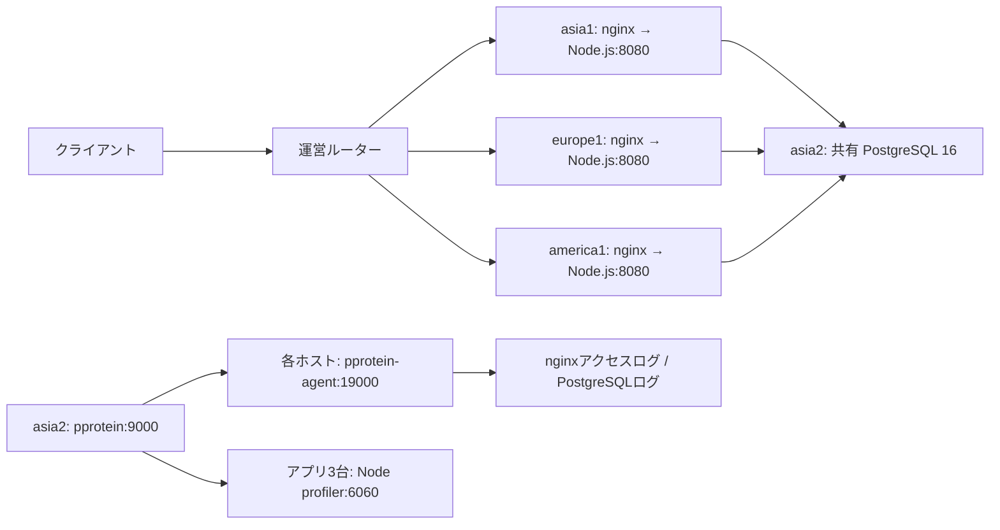

# Node.jsのpprotein収集確認

<<<<<<< HEAD
## 現在の構成（2026-10-31）

Node.js＋nginxのアプリサーバーはasia1・europe1・america1、共有PostgreSQL 16はasia2という構成。
pprotein本体もasia2にあり、各サーバーのpprotein-agentからログ、アプリ3台のNode.jsからCPUプロファイルを収集する。
DBのSQLがasia2に集中する構成は、他3台のslowlogが収集期間中に空だった観測とも整合する。
空ログだけから各ホストのPostgreSQL停止や収集障害を判断しない。各ホストのDB接続先の環境変数値はこの確認では表示・照合していない。

SQLログの収集・保存と解析の成功は分けて確認する。解析の修正経緯は以下の「PostgreSQLの解析モード対応」「PostgreSQLログ形式による取りこぼしとTSV崩れの修正」に記録する。
以下の作業記録にある「未実施」「現在」はそれぞれの確認時点の状態を表す。

## 初回の収集確認
=======
## 再起動直後の設定登録に失敗する場合（2026-10-31）

`14edb12`の全ホストデプロイで、asia2だけ `pprotein-config` のcurl exit 7（127.0.0.1:9000接続拒否）が報告された。
直後の読み取りではpproteinはactive・Result=success・NRestarts=0、`GET /api/group/targets`は200。
systemdの再起動完了とHTTP待受開始の間の競合と整合するため、設定POST前に同GETを上限付きで再試行する処理を追加した。
curlは1回最大2秒・connect timeout 1秒・1秒間隔・最大10回retry・retry開始可能期間15秒とし、接続拒否もretryする。
設定POST自体を再試行する変更ではない。失敗時は `pprotein-health` で止まり、設定POST・ログtruncate・成功記録へ進まない。

RemoteDeployテスト46件成功。再起動→GET起動待ち→設定POSTの順序と、起動待ち失敗時にログ・成功記録を維持することを確認した。
本番はasia2だけをロックし、起動済みpproteinへalp/slpの設定登録だけを再実行、GETのYAML構造がリポジトリの2ファイルと一致することを確認して復旧した。
APIはコメント等を正規化して返すため、バイト一致ではなくYAML構造で比較する。
この復旧ではサービス/DB再起動・ログtruncate・初期化・ベンチは行っていない。
失敗したデプロイの残り全工程を再実行したものではなく、asia2のlast-deploy成功記録は更新していない。次の通常デプロイから起動待ち修正を使う。
>>>>>>> main

2026-10-31に実環境を確認。設定変更・サービス再起動・初期化・ベンチ実行は行っていない。

- asia1 / europe1 / america1の`isureal-nodejs.service`はすべてactive。
- asia1の実サービスのdrop-inには`NODE_OPTIONS=--require /home/isucon/isutools/profiler/profiler.cjs`が設定済み。6060番の待ち受けプロセスはNode.js。
- 3台それぞれの`http://127.0.0.1:6060/debug/pprof/profile?seconds=1`はHTTP 200で応答し、368〜375バイトのプロファイルを取得した。短時間・無負荷での接続確認であり、ベンチ中のサンプル内容は未検証。
- asia2のpproteinの`GET /api/group/targets`はsingle構成。asia1のhttplog、MySQL形式slowlog、6060番のpprofが登録されている。pprofは既にNode.jsを参照しており、切替不要。
- asia2からasia1のプライベートIPの同エンドポイントにも到達し、HTTP 200で取得できた。

PostgreSQLのSQL計測は別途対応が必要。登録済みslowlogはMySQL向けであり、PostgreSQLの収集成功を示さない。PostgreSQLには`log_min_duration_statement`によるSQL実行時間ログがあるが、出力形式と集計処理の適合は未確認。

今回の確認では稼働設定を変更していないため、切り戻し操作は不要。プロファイル全体の自動収集・解析の成功、ベンチ結果・グループIDは未確認。

## PostgreSQL用の設定ファイル追加

2026-10-31、依頼によりasia1 / america1 / europe1 / asia2すべてに、`etc/postgresql/16/main/conf.d/zz-isutools-slowlog.conf`を追加した。リポジトリ内だけの変更で、実環境への配置・reload・再起動は未実行。

実環境で読み取れたasia2の状態は、PostgreSQL 16、設定ファイル`/etc/postgresql/16/main/postgresql.conf`、`include_dir = 'conf.d'`、`logging_collector=off`、`log_min_duration_statement=-1`。他3台のPostgreSQLの導入・稼働・include設定は未確認。

追加設定は全SQLの実行時間を`/var/log/postgresql/postgresql-slow.log`に記録する。slp用のprefixは`%m [%p] `、ログ権限は0640。固定パスを追跡できるよう自動ローテーションは無効で、計測後はログを保全して容量を管理する。全SQLの記録によるI/O負荷を含めて計測する。

ローカルのPostgreSQL 17.11の設定パーサーで4ファイルの読み込みと値を確認した。対象のPostgreSQL 16での起動・ログ生成は未検証。

反映前には以下の対応が必要。

- DBが動く各ホストで、設定ディレクトリの読み込みとログディレクトリへのpostgresの書き込み権限を確認する。初回の`logging_collector=on`適用にはDB再起動が必要なので、担当間で順序・対象を確認する。
- pprotein-agentの`PPROTEIN_SLOWLOG`を上記ログパスへ変更し、`SupplementaryGroups`に`postgres`を追加する。agentの再起動と読み取り確認も必要。
- slowlogの収集対象はDBが実際に動いているホストに合わせる。現在のsingle設定のslowlog対象はasia1で、共有DBのasia2ではない。
- `slp pg --file /var/log/postgresql/postgresql-slow.log --log-line-prefix='%m [%p] ' --sort=sum-query-time --reverse`で集計する。pprotein UIからのPostgreSQL解析への切替は別途確認・対応が必要。
- `isutools/config.env`のDBサービス名・ログパスはまだMySQL用。今回のファイル追加だけでは`task deploy`によるPostgreSQL再起動・ログ管理は対応しない。

全SQL記録を止めるには`log_min_duration_statement=-1`へ変更してreloadする。元の収集方式へ戻す場合は、配置したconfを削除し、DB再起動で`logging_collector=off`に戻ったことを確認する。デプロイのrsyncは削除を同期しないため、Gitで削除するだけでは配置済みconfは消えない。

## groupターゲットを全4台へ変更

2026-10-31、依頼により`task pprotein:targets -- split`を実行し、asia2上のpproteinへ`isutools/pprotein/targets.split.json`を登録した。`GET /api/group/targets`でasia1 / europe1 / america1 / asia2の各httplog・slowlog・pprof、計12件の登録を確認。asia1からpproteinへの接続確認も成功した。

これは収集対象の変更であり、ベンチ・初期化・再起動は実行していない。全12対象の収集・解析成功は未確認。PostgreSQLログへのagent切替・解析対応は上記のとおり未実施。元のasia1のみの対象へ戻すには`task pprotein:targets -- single`を実行する。

## デプロイ時のPostgreSQL設定反映

2026-10-31、依頼により`isutools/config.env`の`DB_SERVICE`を`postgresql@16-main.service`へ変更した。asia2で同クラスタが`enabled-runtime`かつ`active`、親の`postgresql.service`も有効で、`start.conf`が`auto`であることを読み取り確認した。

`task deploy`は従来どおりホスト別の`etc/`を配置し、systemdのdaemon-reload後、有効なDBサービスを再起動する。これによりPostgreSQLの追加confも再起動で反映する。無効・未導入のホストではDBを起動しない。クラスタ本体の起動状態を確認し、失敗時はそのホストのアプリ再起動へ進まずエラーにする。DB再起動コマンド自体の失敗もデプロイ失敗として扱う。

この変更はDB設定の差分にかかわらず、有効なクラスタをデプロイごとに再起動する。実環境へのデプロイ・DB再起動は未実施。次回の実行時は担当間で対象と順序を確認する。SQLログの収集先・解析モードは別途対応が必要で、`SLOW_LOG`は今回変更していない。戻す場合は`DB_SERVICE`を以前の値へ戻す（PostgreSQLのconf自体は残る）。

検証：`python3 -m unittest discover -s isutools/tests -p 'test_*.py'`は112件成功。追加テストは設定コピーとDB→アプリの再起動順序、無効なDBのスキップ、DB起動確認失敗時の中断を確認する。実サーバーへの接続や再起動を行わないテスト。[Issue #2への記録](https://github.com/ue-sho/isucon15/issues/2#issuecomment-6537281731)。

## 自動収集が開始されない原因

2026-10-31の読み取り調査で、asia2のpprotein本体・agentはactive、groupターゲット12件も登録済みだった（各DurationはUI等で120秒に変更されていた）。一方、asia1の稼働コミット`a2ec9d6`の`webapp/nodejs/src/initialize.ts`には収集開始関数のimport・呼び出しがない。サービスには`PPROTEIN_ENABLED=1`と`PPROTEIN_URL`が設定済みだが、これだけでは自動収集は始まらない。

修正箇所はinitializeハンドラ。`isutools/snippets/pprotein-collect.ts`の関数をアプリへ組み込み、初期化時に呼び出す必要がある。今回の調査ではアプリ変更・自動収集開始・初期化・デプロイは行っていない。プロファイラの待ち受けとgroupターゲット登録の成功は、自動収集開始の成功とは別である。

### 初期化ハンドラへの組み込み

同日、依頼を受けて`fix/pprotein-initialize`ブランチで修正した。`webapp/nodejs/src/pprotein.ts`に収集スニペットを組み込み、initializeハンドラの先頭からawaitせずに呼び出す。`PPROTEIN_ENABLED=1`の場合のみgroup収集を要求し、HTTPエラー・接続失敗はログに記録する。2秒のタイムアウト・切断を理由に初期化を失敗させない。

検証は`npm run check`と`npm test`（webapp/nodejs内）を実行。型チェックと4件のテストが成功し、有効時の要求、無効時の抑止、応答待ちによるブロックがないこと、接続失敗時にthrowしないことを確認した。依存導入は`npm ci --no-audit --no-fund`で実施。実環境での収集開始・初期化・デプロイは未実行。反映後、次のベンチの初期化でgroupが作成されることを確認する必要がある。

戻す場合はinitializeハンドラの呼び出しを除去するか、`PPROTEIN_ENABLED=0`をサービスに反映する。

## slowlog収集先の修正

2026-10-31、pproteinで`failed to open /var/log/mysql/mysql-slow.log`が発生。実環境のasia2のagentは旧MySQLパスと`SupplementaryGroups=adm`のままだった。4台ともPostgreSQLクラスタはactiveで、`/var/log/postgresql/postgresql-slow.log`が存在し、所有者postgres:postgres、権限0640であることを読み取り確認した。

4台のagentユニットと共通`SLOW_LOG`をPostgreSQLのログパスに変更し、agentの補助グループへpostgresを追加。設定生成処理もPostgreSQL設定ディレクトリがあるホストでは同グループを生成する。デプロイ時のPostgreSQLログ処理ではtruncateのみ行い、chmodで読み取り権限を広げない。

変更はPR #21に追加。実環境への配置・agent再起動は未実行なので、反映前は同じエラーが続く。PostgreSQLログの収集成功とpprotein UIでの解析成功は別であり、解析モードの対応は未完了。戻す場合はagentユニットとSLOW_LOGを以前の値へ戻してデプロイする。

検証：Python unittest 114件成功。PostgreSQL向けagent生成と、デプロイ時にログの0640が維持されることを追加テストで確認した。

### truncateのPermission denied対応

同日、全4台のデプロイがtruncate段階で失敗したとの報告を受けた。asia2を読み取り確認し、ログディレクトリがroot:postgres・1775、ログがpostgres:postgres・0640、`fs.protected_regular=2`であることを確認した。agentにはPostgreSQLのログパスとpostgresグループが反映済みだった。

通常のtruncateがO_CREATを指定することで、group writableかつstickyなディレクトリ内の他ユーザー所有ファイルへのオープンが保護設定に拒否されたと判断。デプロイのtruncateに`--no-create`を追加し、既存ログのみ処理するよう修正した。ログ権限・所有者・カーネル設定は変更しない。ファイルが消えた場合もroot所有のログを再作成しない。

今回の失敗位置はサービス再起動より後なので、デプロイ失敗でも設定配置・サービス再起動が既に実行されている点に注意。修正後の実環境でのtruncate・再デプロイは未実行。

検証：`python3 -m unittest discover -s isutools/tests -p 'test_remote_bootstrap.py'`の44件成功。ファイル作成を要求するtruncateを拒否する回帰テストを追加した。

## slowlog保存データの実確認

2026-10-31、asia2の`/var/lib/pprotein/data/`と`GET /api/slowlog`を読み取り確認した。

- グループID：`2026-10-31_01-53-00.280779`（UTC、JST 10:53開始）
- 対象コミット：`7c662a83043d9ebae928ca06582d071201ca0c55`
- asia2：`dminci5tvmvs-slowlog.log`、327,014,433バイト、`Status=ok`、`Message=Ready`、収集120秒。
- asia1 / europe1 / america1：`Status=fail`、`Message=received empty content`。対象IDはそれぞれ`dminci5tqxky-slowlog.log` / `dminci5u3g61-slowlog.log` / `dminci5tgnqz-slowlog.log`。共有DBがasia2である構成と整合するが、今回その3台のDBへのSQL流入自体は調査していない。

asia2のSQLログ収集・保存は成功している。pprotein UIのSQL解析成功はこの確認に含まない。ログ本文の持ち出し・全件解析・収集の再実行・ターゲット変更は行っていない。上記収集に対応するベンチID・スコアは未照合。

## PostgreSQLの解析モード対応

保存済みログの先頭64KBで比較したところ、`slp my`では結果0行、`slp pg --log-line-prefix='%m [%p] '`では37行を取得した。pprotein 1.2.4の`internal/extproc/slp/processor.go`は`slp my --output standard --format tsv`を固定で実行するため、PostgreSQLのログは収集できても表示が空になる。

`isutools/pprotein/bin/slp`を追加し、pproteinサービスだけPATHの先頭にそのディレクトリを設定する。MySQL用の呼び出しをPostgreSQL用へ変換し、出力項目を回数・SQL・最小/最大/合計/平均時間に限定する。元の`/usr/local/bin/slp`は置き換えない。pproteinの表はTSVヘッダーから列を生成するため、存在しないMySQL固有のロック時間・走査行数を補う必要はない。既存slp.ymlのフィルターも引き続き適用する。実環境で同フィルターを使った64KBの試験ではヘッダー込み6行を取得した。

修正はPR #21へ追加。実環境へのデプロイ・再起動は未実行。適用後に収集するログはPostgreSQLで解析される。既存IDの空の解析結果はpprotein.dbのcacheバケットに保存されており、再起動だけでは再解析されない。

既存のグループを表示したい場合は、修正のデプロイ後、asia2で次を実行して保存済みログから新しい解析エントリを作成する。元のログとメタデータを残し、元のグループに`asia2-pg`を追加する。DB初期化や新たなSQL負荷収集は行わないが、約327MBの既存ログをコピー・解析するため、ベンチと重ならないタイミングで行う。再登録側のRepository情報は元のメタデータを継承しないため、対象SHAは元エントリ`7c662a8`を参照する。以下は未実行。

```sh
curl -fsS -X POST -H 'Content-Type: application/json' \
  --data '{"GroupId":"2026-10-31_01-53-00.280779","Label":"asia2-pg","URL":"http://127.0.0.1:9000/api/slowlog/data/dminci5tvmvs-slowlog.log","Duration":120}' \
  http://127.0.0.1:9000/api/slowlog
```

切り戻しはpproteinサービスのPATH追加を除去してデプロイする。保存済み原本は変更しない。

検証：呼び出し・出力列の変換、他のslpサブコマンドの維持、サービス設定生成を含むPython unittest 118件成功。実稼働slpで保存ログの先頭64KBをPostgreSQLモード・現在のslp.yml・UI向けの6列指定で解析し、ヘッダーとデータを取得できることを確認した。実環境のpprotein UIでの表示はデプロイ後に確認が必要。

## 確認できたアプリケーション・計測構成



アプリのコードはNode.js・HonoでHTTPを処理し、pgの接続プールでPostgreSQLへ接続する。nginxは127.0.0.1:8080へプロキシする。リージョンとDB接続先は環境変数で指定する。実際のDB接続環境変数の値は今回表示・調査していない。4台ともローカルPostgreSQLクラスタはactiveだが、保存データの観測ではasia2だけにSQLログがあり、他3台は収集期間中空だった。

pprotein本体の作業ディレクトリは`/var/lib/pprotein`、保存先は`/var/lib/pprotein/data/`。agentがログを返し、Node profilerはCPUプロファイルを返す。initializeハンドラからpproteinへgroup収集を要求する。asia2にはNodeアプリが動いておらず、6060番は接続拒否を確認済み。現在のgroup設定にはまだasia2のpprofが含まれ、その対象は成功しない。

## PostgreSQLログ形式による取りこぼしとTSV崩れの修正

最新グループ`2026-10-31_02-04-20.390592`のasia2ログ`dminl6ll2zuo-slowlog.log`は318,249,157バイト、API状態はok / Readyだった。先頭2,097,109バイトだけを調査したところ、durationの内訳はstatement 312件、parse 755件、bind 2,260件、execute 2,250件。既存slpのpgモードはexecuteを取り込まず、複数行SQLが出力TSVを崩していた。さらに旧フィルターは先頭空白・DELETE・WITH等を除外し、この試料では5件しか集計できていなかった。

アダプターにストリーム正規化を追加。statementとexecuteの実行時間・SQLを保持し、executeをslpが扱えるstatement形式へ変換する。SQLの改行・タブ・連続空白を1行の空白へ揃え、Parse/BindおよびパラメーターのDETAIL行は除外する。元ログとDBのSQLは変更しない。トランザクションを含む実行をフィルターで落とさない`isutools/pprotein/slp.yml`を追加した。

同じ試料の修正後は2,562実行・71種類のSQL、総時間103.586692秒となり、元のstatement + execute件数と一致した。すべてのTSV行が6列であることも確認済み。これは先頭2MBの検証であり、318MB全体の件数・時間ではない。初期化先頭で収集を開始するため、初期化SQLも含み得る。

デプロイ処理はpproteinホストでサービス再起動後、リポジトリ内のalp.ymlとslp.ymlをpproteinの設定APIへ登録する。alp.ymlはID・日付を15パターンへ集約し、フィード種別と友達申請の操作を分離する設定。次回デプロイではUIで編集した同設定はリポジトリの内容へ置き換わる。既存の解析キャッシュは更新しないので、既存データの再解析には前述の再登録が必要。

修正後の実環境へのデプロイ・設定登録・全ログ再解析は未実行。

検証：Python unittest 121件成功。複数行executeの正規化、Parse/Bind/DETAILの除外、statementの維持、デプロイ時の解析設定API反映をテストした。alpの代表URLについてもID集約と固定パスの分離をローカルで確認した。
