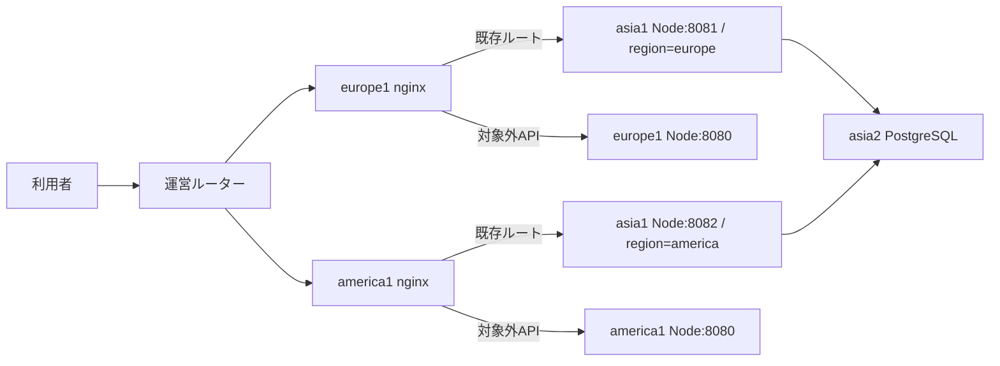

# 投稿・友達フィードをDB近傍の地域別アプリへ転送

2026-10-31。[Issue #29](https://github.com/ue-sho/isucon15/issues/29)。
ブランチ `perf/regional-api-proxy`、起点は最新main `f1797e6`。
#13の署名・#15のロック・#19のフィードSQLの変更は含めない。

## 本番反映の記録（2026-10-31）

ユーザーのpush・本番適用の依頼により、asia1→疎通確認→europe1/america1の順で `ef49e1d3c997c3285d1472b560c534bba99b951a` を反映した。
別担当の既存改善を巻き戻さないため、最新main `3a19a28` を統合し、投稿共有ロックと画像署名キャッシュを維持した。
この変更自体による署名・投稿ロック方式の修正ではない。統合後の型チェック成功、Nodeテスト34件成功・専用DBテスト3件skip。

- 初回はasia1からGitHubへのSSH認証で失敗し、設定配置・再起動前に停止。ユーザー許可でローカル一時SSHエージェントへ既存鍵を追加し、転送を使って再実行した。鍵本体はサーバーへ配置していない。
- asia1の通常サービスと地域別補助2つはactive、8080/8081/8082で待受。親は永続的にenabledで `/etc/systemd/system/multi-user.target.wants/isureal-nodejs.service` が存在する。
- 補助のUnitFileStateはstaticだが、親のWantsから起動する。両補助のPartOfも実機確認済み。3台のロックを取得し、親の再起動で3プロセスのPIDがすべて変わりactiveへ復帰することを検証した。
- europe1→8081、america1→8082で未認証APIが401。edge切替後の両nginx経由も401。本番nginx -tは両方成功。これは疎通・認証拒否の確認であり、正常ユーザーの投稿・期間内検証成功を実測したものではない。
- europe1/america1のNodeとnginxも永続enabled。共有DBはasia2のまま。各サーバーの既存PostgreSQL再起動もユーザー許可の範囲でtask deployが実施した。DB分散・レプリカ追加は行っていない。
- asia2はmax_connections=100、superuser_reserved_connections=3。確認時のclient backendは6接続で、これは低負荷時の観測に限る。
- asia2のcheckoutは既存の `84806f5` のまま。今回の対象はアプリ3台で、asia2の設定配置・DB再起動・SQLログtruncateは行っていない。

切替前3台のアクセスログ・SQLログ・nginx site設定は手元 `/tmp/isu15-regional-prod.sxrKeS/*-before.tar.gz` に保全。
実行ログは同ディレクトリの `asia1-deploy.log`（認証失敗）、`asia1-deploy-retry.log`、`edges-deploy.log`。
旧アプリ版は `84806f5`。切り戻しは下記のとおりedge経路を先に戻し、追加confの明示撤去が必要。
実サーバー全体の再起動、初期化60秒、正常ユーザー操作・前後ベンチ、スコア改善は未検証。
以下の設計・手元試験・手順の「未実施」は、その記録時点の状態を表す。現在の反映状態はこの節を参照する。

## 採点条件と優先した理由

[公式マニュアル](manual-2026-10-31.md#スコアの計算)では、投稿受理後に期間終了前の友達フィード検証が成功すると通常10点、最後の期間20点。
europe/americaは1.5倍なので15点/30点になり、その後の閲覧・RealMoji・コメントにも進める。
投稿201だけを増やすことと採点件数を増やすことは同じではない。

コード調査では投稿は認証・BEGIN/COMMITを含め通常10DB往復、友達フィードは友達ありで通常7DB往復（IPBan等は除外）。
元の遠隔アプリはSQLごとに地域間の遅延付き経路を通る。
HTTPを1回転送し、SQLをDBと同じ競技リージョンから実行すれば、投稿と検証の両方でこの往復をまとめられる。
地域間RTTをRとした単純モデルでは通信待ち削減候補は投稿で約9R、友達フィードで約6R。ただしDB/ロック待ち・CPU・転送量・pool待ちは残り、実際の短縮時間や得点増を表す数値ではない。

従来の観測（グループ `2026-10-31_02-26-56.726243`、収集SHA `890d153`）では、投稿平均はeurope1で2.697秒、america1で2.167秒。
保存ファイルはそれぞれ `dmio2how832b-httplog.log` / `dmio2howejka-httplog.log`、全status混在。
画像・SQLの別改善後の現在mainに対する対照ベンチではないため、この値から今回のスコア向上は算出しない。

## 許容される構成と確認元

- 全サーバーの物理配置はAWS ap-northeast-1。競技上のasia/europe/americaの遅延・帯域制限は運営ルーターによるもの。
- europe1/america1のnginxからasia側アプリへproxy_passする構成は許容される。
- ユーザーの接続先、X-Country-Codeによる振分け、VPCルートどおりのルーター経由通信は維持する。ルーターやVPCのルートは変更しない。
- 本番はsystemd＋Node.js＋nginx。コンテナを配置しない。コンテナは手元検証にだけ使用する。

API転送の許可は運営Clarification #20（回答10:48:09.556）で確認された。質問と運営の「はい」の全文をユーザーから受領したもので、こちらから認証済みポータルとの再照合はしていない。
物理配置と本番の非コンテナ運用はユーザーからの追加情報。[運営回答の記録](clarifications-2026-10-31.md)を参照。
読み取り時にasia1のIP `192.168.1.10` と8080の待受、europe1→同IPが192.168.2.1経由、america1→同IPが192.168.3.1経由であることを確認した。
新ポートの本番疎通は未確認。

## 処理経路



次の4パスだけをexact locationで転送する。URI・クエリ・メソッドを変えない。

| パス | 目的 |
|---|---|
| `/api/posts` | 投稿の直列DB往復 |
| `/api/feeds/friends` | 投稿期間内の検証 |
| `/api/posting-window/current` | 投稿準備・投稿可否確認 |
| `/api/posts/me/current` | 自分の投稿確認 |

その他のAPIは従来の127.0.0.1:8080で処理する。画像配信・大きな履歴・不正プロフィール画像などのCPU/転送処理を全てasia1へ集めない。
Authorization・X-Client-IP・X-Country-Codeは受信値を転送し、Hostも従来どおり維持する。
HTTP/1.1 keepaliveを使い、`proxy_next_upstream off`で書込失敗時の再送・別リージョンへのfallbackをしない。
転送先が利用不能なら502等になるため、backendを先に起動・確認してからedgeへ反映する。

## アプリ・systemd

`ISUREAL_PORT`を追加（既定8080）。1〜65535の整数のみを許可。
asia1に `isureal-nodejs-europe.service` / `isureal-nodejs-america.service` を追加する。
`/usr/bin/env`で元のEnvironmentFileより後に地域・ポート・worker・poolを指定し、asia用設定に戻ることを防ぐ。
regionMiddleware自体は変更せず、毎回DBから得たユーザー地域と専用アプリ地域を比較する。外部ヘッダーによる地域上書きはしない。

各アプリは1worker、pool上限2。元の3台×2worker×pool15が既定なら最大90接続に4を足して94となり、max_connections=100・superuser_reserved_connections=3に対して残り3接続。
これはソースの既定値に基づく見積もりで、実環境のpool数・別接続は未照合。反映前に実際の接続余力を確認し、必要なら既存poolも含めて予算を調整する。
asia1のCPU集中と小さいpoolによる待ちが新たな律速になる可能性がある。

asia1の親サービスのdrop-inにWantsを追加し、補助2サービスにはPartOfを設定する。
親サービスの起動時に両方を起動し、既存デプロイによる親の再起動・停止も補助へ伝播させる。
補助が失敗しても親のis-activeだけでは検出できないので、2サービスのactive状態と待受を必ず別に確認する。
既存のpprotein CPU対象は補助プロセスを含まない。比較時にはasia1の全NodeプロセスのCPU/RSSを確認し、補助のCPUを既存pprofに含まれるものとして扱わない。

DBスキーマ、トランザクション、署名、画像保存、初期化SQL、追加の共有キャッシュは変更しない。
全プロセスは同じ共有DBを使うため、データ複製や初期化の複製先は増えない。IPBanは既存実装のプロセス内reloadのまま。

## 手元の検証

- Node.js 26.10.0の型チェック成功。
- Nodeのテストは25件成功・画像用DB統合テスト1件skip。追加したテストではeurope/americaとユーザー地域の組合せ、偽の地域ヘッダーで判定を迂回できないことを確認。
- 専用のPostgreSQL 16と3地域の実Node HTTPサーバーで投稿201、二重投稿409、別地域403、投稿後の友達フィード、自分の現在投稿、現在投稿枠、共有DBのblock書込直後の不可視化を確認。
- 手元nginx 1.24.0の `nginx -t` と転送試験が成功。両地域の設定を読み込み、転送4パス・対象外9パス、認証/クライアントIP/国コード、query、multipart本文、409の保持、upstream切断時にPOSTを1回だけ送ることを確認。
- systemd-analyze verifyで補助サービスの構文を確認。実systemdでの起動・PartOf/Wants伝播は本番未検証。

再現には新規の手元DB `isureal_regional_api_test` を作り、`REGIONAL_API_TEST_PG_PORT`を指定してwebapp/nodejsで `npm test` を実行する。
実サービスの接続情報は使わない。DB未指定時はこの統合テストをskipする。
nginx試験は `ISUTOOLS_NGINX_PROXY_TEST=1 python3 -m unittest discover -s isutools/tests -p test_regional_api_proxy.py -v`。
これは手元だけのDockerを使う。本番導入手順にDockerは含めない。

### 遅延を加えたローカル比較

2026-10-31、最新mainの投稿共有ロック改善を取り込んだ `6189833` の実装に対して測定。
PostgreSQL 16、Node.js 26.10.0、合成ユーザー・友達・投稿を使用。各方式1回のwarmup後に6回ずつ交互実行、同時実行数1。
「遠隔SQL」はNode→DBのTCP経路に往復80ms、「HTTP転送」はHTTP→DB近傍NodeのTCP経路に往復80msを設定した。
両方向のTCPデータ配送へ40msずつ加えたモデルであり、実ルーターの帯域制限・パケット挙動・同時負荷を再現するものではない。
nginx自体はこの測定経路に挟まず、別のnginx転送試験と分けている。

| 方式 | 投稿の平均/中央値/最大 | 友達フィードの平均/中央値/最大 |
|---|---|---|
| 遠隔SQL | 903 / 903 / 906ms | 656 / 656 / 658ms |
| HTTP転送 | 95 / 95 / 99ms | 90 / 89 / 91ms |

すべて投稿201と、投稿後の友達フィードが期待する投稿IDを返すことを確認して測定した。
これはHTTPの処理時間であり、公式の期間内検証通過数・スコア・本番改善率ではない。
本番のCPU集中、DBの混雑・pool待ち、大きな画像、同時投稿、初期化60秒を含む評価は残る。
このモデルではAPI転送の効果が大きいため、まずこれを比較基準にし、その後に同期レプリカや画像シャーディングの追加効果を検討する。

再現は新規の手元DBに対しwebapp/nodejsで以下を実行する。既存DBへ繰り返し投入しない。

```sh
REGIONAL_API_TEST_PG_PORT=15440 REGIONAL_API_BENCH_RTT_MS=80 node --test test/regional-api-db.test.ts
```

## 反映の順序（未実施）

担当とベンチ終了・計測ログ保全を確認してから行う。まずコミットをpushし、同じ版を順に反映する。
`task deploy`はDBを含むサービスの再起動・ログtruncateを伴うため、以下も単なる設定コピーとは扱わない。

1. `HOSTS=asia1 task deploy BRANCH=perf/regional-api-proxy`。
2. asia1の親＋補助2サービスのactive、8080/8081/8082待受を確認。未認証で8081/8082の `/api/posting-window/current` が401を返すこと、europe1/america1から各専用ポートへ同じ401が返ることを確認。ルート・FW変更が必要なら影響を確認して別途調整。
3. `HOSTS="europe1 america1" task deploy BRANCH=perf/regional-api-proxy`。nginx -tとサービス状態を確認。
4. ポータル経由の正常操作で各地域の投稿・friends feed・現在投稿枠を確認。HTTP上のユーザー地域を変えない。
5. 調整済みベンチで成否・地域別/期間別の検証通過数・総スコア、投稿/検証のp95、asia1 CPU/RSS、DB接続数/pool待ちを比較。group ID・各ホストSHA・ログ名を記録する。
6. 親サービス再起動とサーバー再起動後の補助起動・データ取得、初期化後の全地域の状態を確認する。初期化は運営Clarification #32の60秒以内に完了すること。

現時点で本番配置・有効化・デプロイ・再起動・初期化・ベンチは行っていない。スコア改善は未確認。

## 戻し方

先にeurope1/america1の4つのexact locationを削除した元の設定を反映し、nginx -t後にreloadする。全APIが元の各地域8080へ戻ってから補助を止める。
次にasia1の親drop-in `regional-api.conf` を撤去してdaemon-reloadし、補助2サービスを停止する。
追加ファイルはasia1のdrop-inと補助service2本、各edgeのconf.d/snippet各1本。デプロイrsyncは削除を同期しないため、Gitのrevertだけで実機から撤去済みとは扱わず、追加ファイルの明示撤去・daemon-reload・nginx -tを確認する。
DBや保存データの復元は不要。`ISUREAL_PORT`のコード追加は未指定時8080なので、旧経路に影響しない。
